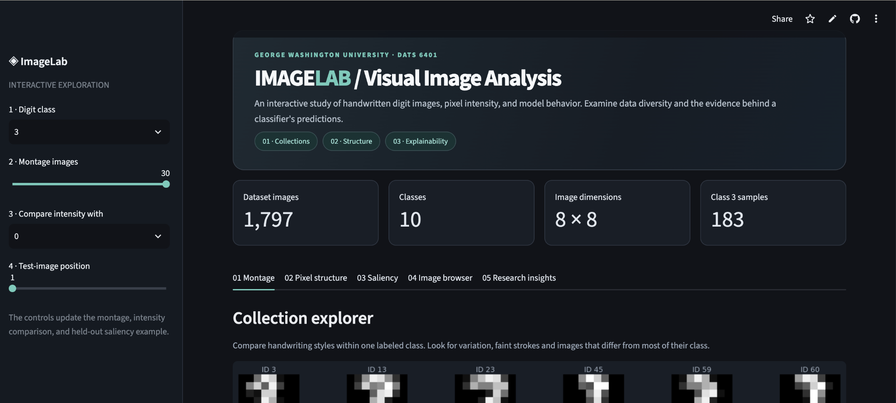
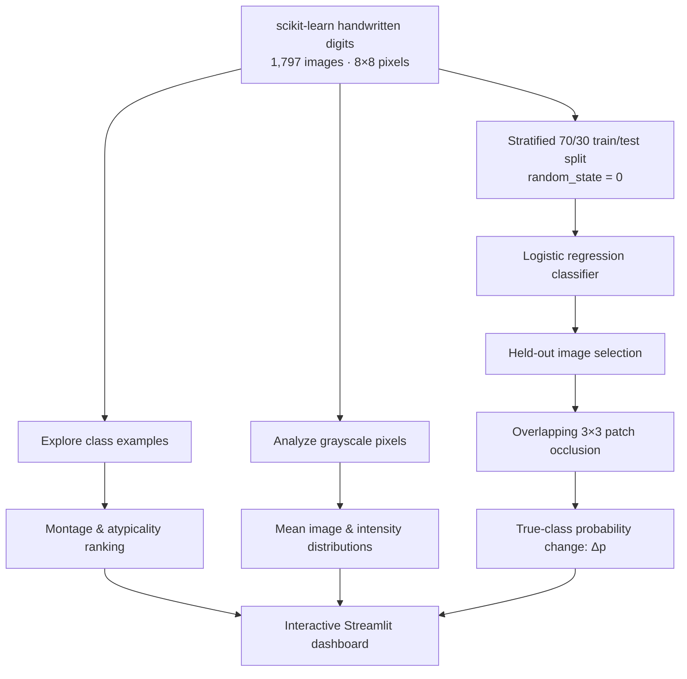

<div align="center">

# ◈ ImageLab

### Interactive Image Analytics · From Pixels to Model Evidence

**Explore handwriting variation, compare grayscale structure, and inspect what changes a classifier's confidence.**

[](https://image-lab-interactive-image-analytics.streamlit.app/)
[](https://github.com/nazishatta/image-lab-interactive-image-analytics)


[**Live app**](https://image-lab-interactive-image-analytics.streamlit.app/) · [**Features**](#-five-ways-to-explore-the-data) · [**Methods**](#-methods--scientific-interpretation) · [**Run locally**](#-run-it-locally) · [**Exploration guide**](#-guided-exploration)

</div>

---

## The question behind ImageLab

**What can 8 × 8 grayscale images reveal about visual variation—and what does a model actually rely on to recognize a digit?**

A digit class isn't a single shape. Handwriting varies in stroke thickness, location, slant, brightness, and ambiguity. ImageLab links *what the images look like* with *how their pixels are distributed* and *how a classifier responds when regions are hidden*.

> **Analytical principle:** Look at examples, check the intensity structure, then test model sensitivity. A vivid heatmap is not, by itself, an explanation of how a model reasons.

<div align="center">

### Dashboard preview

[](https://image-lab-interactive-image-analytics.streamlit.app/)

*Click the preview to open the interactive application. Screenshot shows one dashboard state; controls change the views.*

</div>

## Dataset at a glance

<div align="center">

| Images | Digit classes | Image size | Pixel range |
|:---:|:---:|:---:|:---:|
| **1,797** | **10** (`0`–`9`) | **8 × 8** | **0–16** |

</div>

**Source:** The [`load_digits` dataset](https://scikit-learn.org/stable/modules/generated/sklearn.datasets.load_digits.html) distributed with scikit-learn. Each observation has 64 grayscale pixel values and an associated digit label. No external dataset download is needed.

---

## ✨ Five ways to explore the data

| Workspace | Explore and interact | Analytical question |
|:---|:---|:---|
| **01 · Montage** | Choose a digit, number of examples, and ordering: dataset order / seeded shuffle / most atypical first | How much can writing styles vary within one class? |
| **02 · Pixel structure** | View mean images, intensity distributions, and a comparison digit | How do bright strokes and empty backgrounds differ between classes? |
| **03 · Saliency** | Select a held-out test example; inspect signed occlusion response and positive-drop overlay | Which hidden patches change the true-class probability most? |
| **04 · Image browser** | Inspect individual digit IDs; upload PNG/JPG for grayscale, blur, edge, or inversion demonstrations | What happens to visual information under simple image transformations? |
| **05 · Research insights** | Review class-level statistics, model recall, unusual examples, and limitations | What observations are supported by the data—and what remains uncertain? |

The **shared sidebar** changes the selected digit, montage size, comparison class, and held-out image position. The montage also has its own reproducible ordering control.

### 01 · Montage: variation within a label

The montage uses a common **0–16** grayscale scale so brightness can be visually compared across images. Original dataset IDs are preserved. A seeded shuffle provides repeatable variety, while *most atypical first* prioritizes examples farther from their class mean in pixel space.

**Read carefully:** Atypical does **not** automatically mean mislabeled, corrupted, or out of distribution. It means different under this particular distance measure.

### 02 · Pixel structure: image statistics, not just appearance

The structure view uses class-normalized, integer-centered intensity histograms with ticks at **0, 4, 8, 12, and 16**. When comparing classes, a separate **nonzero-pixel** distribution makes stroke intensity easier to inspect without the background peak dominating the comparison.

**Read carefully:** An average image blends many handwriting samples; it is a useful summary of common stroke locations, not a typical individual handwritten digit.

### 03 · Saliency: test the classifier by hiding regions

ImageLab trains a logistic-regression classifier and explores **overlapping 3 × 3 occlusion patches** on held-out digit images. For each patch center it calculates:

$$
\Delta p = P(y_{\mathrm{true}}\mid x_{\mathrm{original}})
         - P(y_{\mathrm{true}}\mid x_{\mathrm{occluded}})
$$

| Sign | What it means |
|:---|:---|
| **Positive Δp** | Hiding that patch **decreases** probability assigned to the *true* class. The original region supported that class under this intervention. |
| **Negative Δp** | Hiding that patch **increases** probability assigned to the *true* class. |
| **Near-zero Δp** | Hiding that patch changes the true-class probability very little. |

The signed map and positive-drop overlay show related but different views. A highlighted map position describes the effect of an **occlusion window centered there**, not the importance of a single independent pixel.

**Read carefully:** These are local sensitivity measurements, not a proof of causality or model understanding. The target is the **true label**, including when the model misclassifies an example.

### 04 · Image browser: inspect and transform

Explore a source image by its dataset ID, or upload a PNG/JPG to try visual processing demonstrations including grayscale, blur, edges, and inversion. The uploaded-image workflow is auxiliary; the primary dataset analysis uses the packaged scikit-learn digits data.

### 05 · Research insights: turn figures into defensible findings

The insights view connects class variation, pixel patterns, and held-out model behavior. It distinguishes **unusual examples** from confirmed labeling problems and reports **class recall** as distinct from overall classifier accuracy.

---

## 🧪 Methods & scientific interpretation



| Stage | Implementation |
|:---|:---|
| Image source | `sklearn.datasets.load_digits()` |
| Preprocessing | Original 8 × 8 pixel intensities, 0–16 |
| Model | `LogisticRegression(max_iter=5000, random_state=0)` |
| Evaluation design | Stratified **70% training / 30% test** (`random_state=0`) |
| Split sizes | **1,257 training / 540 held-out test** images |
| Held-out accuracy | **96.1%** in the audited environment |
| Local explanation | Mask overlapping **3 × 3** regions; recompute true-class probability |
| Reproducible montage shuffle | Seed **42** |
| Visualizations | Matplotlib, rendered in Streamlit |

> **Evaluation boundary:** The stratified held-out split prevents overlap between training and test image IDs. It does **not** establish performance on entirely new writers, scanners, or image domains. Occlusion is a perturbation test, and blanking a region can produce unnatural input patterns.

---

## 🎛️ Guided exploration

<details>
<summary><b>🧭 Path A — Explore handwriting variation (3 minutes)</b></summary>

1. Open **01 Montage** and select digit **3**.
2. Compare **12** images with **30** images.
3. Switch from **Dataset order** to **Reproducible shuffle**; switch back to check its repeatability.
4. Choose **Most atypical first**. Identify an unusual stroke shape or position.
5. Ask: *Is this genuinely a bad label, or just a rarer writing style?*

</details>

<details>
<summary><b>📊 Path B — Compare the pixel structure of two digits</b></summary>

1. Choose digit **4**.
2. Set **Compare intensity with** to **3**.
3. Open **02 Pixel structure**.
4. Compare the full distributions, especially the large spike at zero.
5. Inspect the nonzero-only comparison to focus on the brightness of strokes.
6. Ask: *Are differences due mainly to background occupancy or to stroke brightness?*

</details>

<details>
<summary><b>🔍 Path C — Challenge a model explanation</b></summary>

1. Select digit **4** and open **03 Saliency**.
2. Change **Test-image position** to compare held-out images.
3. Read the model's true-class probability and its predicted class.
4. Compare the signed Δp map with the positive-drop overlay.
5. Ask: *Where does masking reduce true-class probability most? Does this correspond to a visible stroke?*
6. Remember that the reported effect belongs to the **masked patch**, not necessarily a single important pixel.

</details>

<details>
<summary><b>🖼️ Path D — Test simple image transformations</b></summary>

1. Open **04 Image browser**.
2. Inspect individual digit IDs in the first subtab.
3. In **Upload and compare**, use the built-in demo image or supply a PNG/JPG.
4. Compare **Grayscale**, **Blur**, **Edges**, and **Invert**.
5. Ask: *Which transformations keep the written symbol recognizable?*

</details>

---

## 💻 Run it locally

<details>
<summary><b>Show installation and launch commands (macOS / Linux)</b></summary>

**Prerequisite:** A compatible Python 3 environment and Git.

```bash
git clone https://github.com/nazishatta/image-lab-interactive-image-analytics.git
cd image-lab-interactive-image-analytics
python3 -m venv .venv
source .venv/bin/activate
python -m pip install -r requirements.txt
python -m streamlit run app.py
```

Open **http://localhost:8501** (or the URL Streamlit prints).

</details>

<details>
<summary><b>Show installation and launch commands (Windows PowerShell)</b></summary>

```powershell
git clone https://github.com/nazishatta/image-lab-interactive-image-analytics.git
cd image-lab-interactive-image-analytics
py -m venv .venv
.venv\Scripts\Activate.ps1
python -m pip install -r requirements.txt
python -m streamlit run app.py
```

</details>

<details>
<summary><b>What is required for deployment?</b></summary>

The main app entry point is **`app.py`**. Streamlit Community Cloud installs Python packages from **`requirements.txt`** and loads the included scikit-learn digits dataset at runtime. The dashboard's primary analysis does not require an API key or remote dataset service.

</details>

## 🧰 Technology stack

| Layer | Tools |
|:---|:---|
| Interface and interaction | Streamlit |
| Arrays and pixel operations | NumPy |
| Image and statistical charts | Matplotlib |
| Dataset, stratified split, classifier | scikit-learn |
| Optional upload transformations | Pillow (PIL) |
| Source control and hosting | GitHub · Streamlit Community Cloud |

## 📁 Repository orientation

```text
image-lab-interactive-image-analytics/
├── app.py                # Main five-tab Streamlit dashboard
├── requirements.txt      # Runtime dependencies
├── .streamlit/
│   └── config.toml       # Streamlit visual theme
├── .gitignore            # Local-only file exclusions
├── README.md             # Project overview and guide
└── preview/
    └── dashboard.png     # README screenshot (included with this README pack)
```

> Other development or test files may appear in the repository. The tree above highlights the core app files and the screenshot added by this documentation pack.

## ⚠️ Interpretation boundaries

<details>
<summary><b>Expand limitations and responsible interpretation</b></summary>

- **Low resolution:** Images have only 64 pixels. Small shifts can have large apparent effects.
- **Atypical ≠ erroneous:** Distance from a class mean is not evidence that a label is wrong.
- **Feature sensitivity ≠ causality:** Masking a region changes the input, sometimes in unrealistic ways.
- **Overlapping occlusion:** Map entries describe overlapping patch centers, not independent pixel attributions.
- **Accuracy ≠ generalization:** Performance on a stratified image-level split does not prove writer-independent performance.
- **Model probability ≠ guaranteed truth:** Predicted class probabilities can be miscalibrated.
- **Intensity comparison:** A large number of zero pixels reflects background area and can dominate a full histogram.

</details>

## 🤝 Development acknowledgment

AI assistance supported portions of application scaffolding, styling, debugging, documentation, and code review. Model outputs and scientific interpretations should be checked against the executable analysis and source data.

---

<div align="center">

### Designed and developed by

**Nazish Atta**  
M.S. Data Science · The George Washington University

[](https://github.com/nazishatta)
[](https://image-lab-interactive-image-analytics.streamlit.app/)

**◈ Explore the pixels. Question the predictions. Understand the evidence.**

</div>
